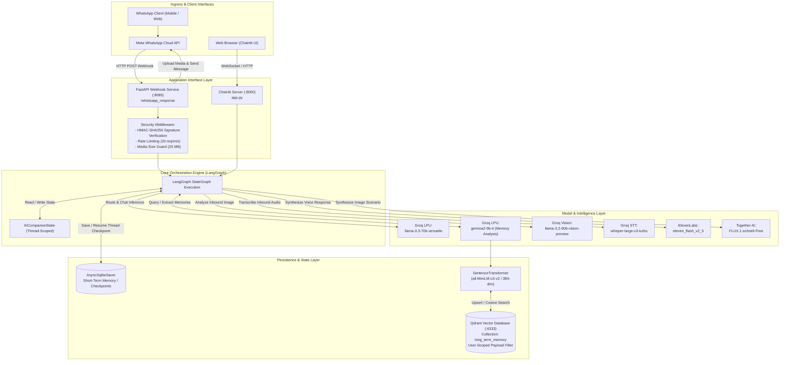
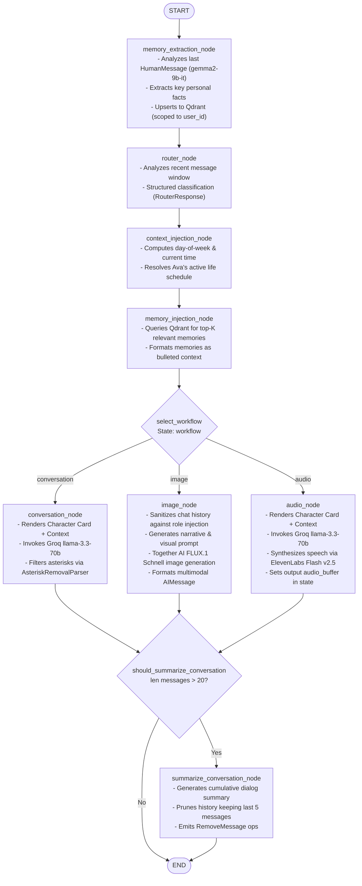
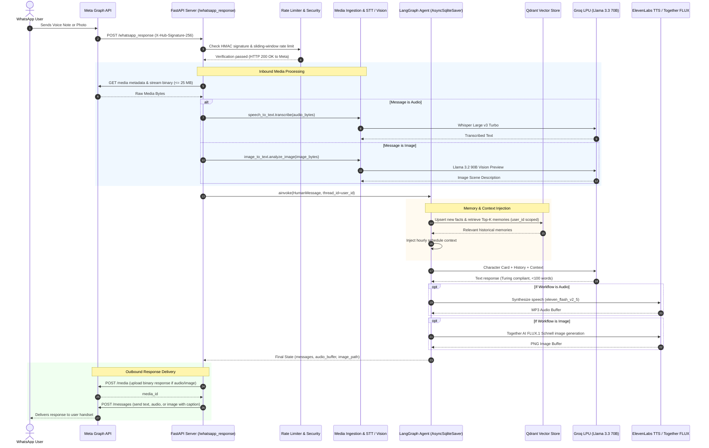
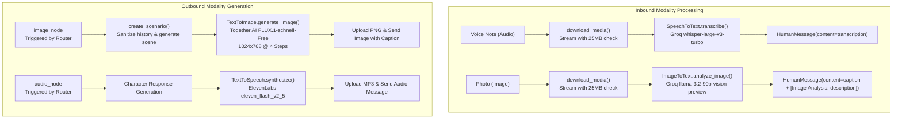
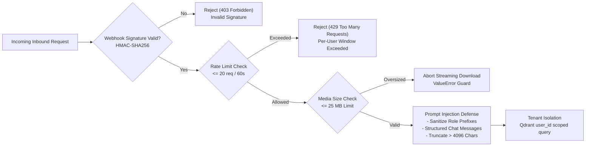
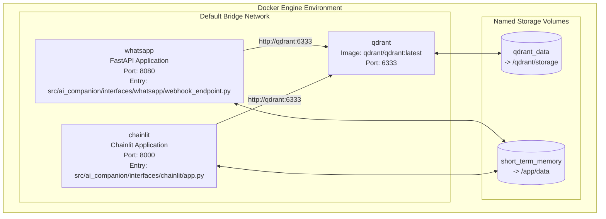

# 🌟 Ava: Autonomous Multimodal WhatsApp AI Agent

[](https://www.python.org/)
[](https://github.com/langchain-ai/langgraph)
[](https://fastapi.tiangolo.com)
[](https://qdrant.tech/)
[](https://groq.com/)
[](https://together.ai/)
[](https://elevenlabs.io/)
[](https://www.docker.com/)
[](https://github.com/astral-sh/ruff)
[](LICENSE)

**Ava** is an enterprise-grade, stateful, multimodal AI conversational agent designed to deliver human-level interactions over the **WhatsApp Cloud API** and modern interactive web interfaces via **Chainlit**. 

Engineered around **LangGraph** cyclical state machines, Ava combines real-time ultra-low-latency inference (Groq LPUs), bidirectional multimodal capabilities (Vision, Speech-to-Text, Text-to-Speech, and Text-to-Image), a dual-tier memory architecture (asynchronous SQLite checkpointing and Qdrant semantic vector storage), and dynamic temporal schedule awareness.

---

## 📑 Table of Contents

- [Project Overview](#-project-overview)
  - [The Problem](#the-problem)
  - [The Solution](#the-solution)
  - [Intended Use Cases](#intended-use-cases)
- [Key Features](#-key-features)
- [System Architecture](#-system-architecture)
  - [High-Level Architectural Overview](#high-level-architectural-overview)
  - [LangGraph State Machine Pipeline](#langgraph-state-machine-pipeline)
  - [End-to-End Multimodal Sequence Flow](#end-to-end-multimodal-sequence-flow)
  - [Dual-Tier Memory Topology](#dual-tier-memory-topology)
- [Technology Stack](#-technology-stack)
- [Project Directory Structure](#-project-directory-structure)
- [Core Subsystems Deep Dive](#-core-subsystems-deep-dive)
  - [1. LangGraph State Machine & Dynamic Routing](#1-langgraph-state-machine--dynamic-routing)
  - [2. Dual-Tier Memory System](#2-dual-tier-memory-system)
  - [3. Multimodal Processing Engine](#3-multimodal-processing-engine)
  - [4. Dynamic Context & Life Schedule Engine](#4-dynamic-context--life-schedule-engine)
- [Security & Production Hardening](#-security--production-hardening)
- [Environment Configuration](#-environment-configuration)
- [Installation & Local Setup](#-installation--local-setup)
  - [Prerequisites](#prerequisites)
  - [Local Installation with uv](#local-installation-with-uv)
  - [Qdrant Vector Database Setup](#qdrant-vector-database-setup)
- [Usage Guide](#-usage-guide)
  - [Running the WhatsApp Webhook Service](#running-the-whatsapp-webhook-service)
  - [Running the Chainlit Web UI](#running-the-chainlit-web-ui)
  - [Exposing Webhook via Reverse Proxy (ngrok / Cloudflare Tunnel)](#exposing-webhook-via-reverse-proxy-ngrok--cloudflare-tunnel)
- [API Reference](#-api-reference)
  - [WhatsApp Webhook Verification (GET)](#whatsapp-webhook-verification-get)
  - [WhatsApp Inbound Event Ingestion (POST)](#whatsapp-inbound-event-ingestion-post)
- [Docker & Containerized Deployment](#-docker--containerized-deployment)
  - [Multi-Container Architecture](#multi-container-architecture)
  - [Common Makefile Operations](#common-makefile-operations)
- [Testing & Quality Assurance](#-testing--quality-assurance)
- [Future Roadmap](#-future-roadmap)
- [Contributing](#-contributing)
- [License](#-license)

---

## 💡 Project Overview

### The Problem
Traditional conversational chatbots are stateless, text-only, and reactive. They suffer from context drift across long conversations, lack genuine multimodal perception (inability to organically process images or voice notes in real time), and exhibit synthetic corporate personas that fail human conversational Turing evaluations. Furthermore, most systems lack per-user memory privacy, risking cross-tenant data leaks in vector stores.

### The Solution
**Ava** solves these limitations by implementing a fully autonomous, persona-driven agent with:
1. **Multimodal Fluency:** Listens to voice notes (Groq Whisper), views user images (Groq Llama 3.2 Vision), speaks back using expressive synthesized audio (ElevenLabs Flash v2.5), and generates context-aware scenario images on demand (Together AI FLUX.1 Schnell).
2. **Cognitive Continuity:** Retains rolling conversational context using an asynchronous SQLite checkpointer, coupled with user-scoped vector memory (Qdrant + `all-MiniLM-L6-v2`) that automatically extracts, deduplicates, and retrieves personal user facts.
3. **Temporal Realism:** Emulates a living schedule (Monday through Sunday) as a 26-year-old Machine Learning Engineer at Groq based in San Francisco, grounding responses in her current activity without artificial robotic disclosures.
4. **Enterprise Defense-in-Depth:** Integrates cryptographic webhook verification (HMAC-SHA256), sliding-window rate limiting, input boundary enforcement, and prompt injection neutralization across image and memory extraction chains.

### Intended Use Cases
- **Autonomous Digital Companionship:** Natural, lifelike conversational agents on WhatsApp and web platforms.
- **Customer Care & Concierge Agents:** Multimodal assistants capable of inspecting user photos, listening to audio queries, and maintaining long-term customer context.
- **Reference Architecture:** A production-grade blueprint for orchestrating stateful, multi-provider LLM pipelines with LangGraph, Groq, Qdrant, and Meta WhatsApp Cloud API.

---

## ⚡ Key Features

| Feature | Description | Engine / Model |
| :--- | :--- | :--- |
| **Stateful Graph Orchestration** | Cyclic graph workflows with conditional execution, context injection, and state checkpointing | **LangGraph** (`v0.2.60`) |
| **Ultra-Low Latency LLM** | Sub-second natural conversation generation with strict roleplay constraints (<100 words) | **Groq** (`llama-3.3-70b-versatile`) |
| **Intelligent Routing** | Zero-shot intent classification determining whether text, voice, or image generation is required | **Groq** (`llama-3.3-70b-versatile`) |
| **Speech-to-Text (STT)** | Inbound voice note transcription from OGG/MP3 WhatsApp audio payloads | **Groq Whisper** (`whisper-large-v3-turbo`) |
| **Text-to-Speech (TTS)** | Ultra-expressive voice response generation with dynamic stability and similarity tuning | **ElevenLabs** (`eleven_flash_v2_5`) |
| **Visual Scene Understanding** | High-fidelity image recognition and situational comprehension of uploaded user photos | **Groq Vision** (`llama-3.2-90b-vision-preview`) |
| **Generative Image Synthesis** | First-person scenario generation and text-to-image synthesis on explicit visual request | **Together AI** (`FLUX.1-schnell-Free`) |
| **Long-Term Vector Memory** | Automated fact extraction, cosine deduplication (threshold 0.90), and isolated semantic retrieval | **Qdrant** + `all-MiniLM-L6-v2` |
| **Context Window Compaction** | Automated conversational summarization and state pruning when message history exceeds 20 items | **LangGraph** + `RemoveMessage` |
| **Schedule Awareness** | Hourly calendar awareness mapping Ava's activity to real-world time-of-day and day-of-week | **ScheduleContextGenerator** |
| **Dual Presentation Interfaces** | Meta WhatsApp Cloud API webhook endpoint alongside an interactive Chainlit Web UI | **FastAPI** + **Chainlit** |
| **Production Security** | HMAC-SHA256 signature verification, 25 MB media guards, sliding-window rate limiter, and role injection defenses | **FastAPI Middleware & Python Cryptography** |

---

## 🏗️ System Architecture

### High-Level Architectural Overview

The following diagram illustrates how clients communicate through ingress interfaces into the core orchestration engine, which interacts with external model APIs, vector stores, and persistent databases.



---

### LangGraph State Machine Pipeline

Every incoming user turn executes as an atomic run through the compiled state graph. The graph is deterministic in structure while dynamically routing execution based on classification:



---

### End-to-End Multimodal Sequence Flow

The following sequence illustrates the complete lifecycle of a user sending an audio or image message through WhatsApp to receiving an orchestrated multimodal response:



---

### Dual-Tier Memory Topology

```mermaid
flowchart LR
    subgraph InboundTurn ["Inbound Dialog Turn"]
        HM["Human Message Content"]
        UserID["User Phone / Session ID"]
    end

    subgraph Tier1 ["Tier 1: Short-Term Operational Memory"]
        SQLite["SQLite Checkpointer\n(AsyncSqliteSaver)"]
        ThreadState["Thread Checkpoint\n(thread_id = user_id)"]
        Compaction["Rolling Compaction Engine\nTrigger: >20 Messages\nPrunes to: Last 5 Messages\nSummary: System State"]
    end

    subgraph Tier2 ["Tier 2: Long-Term Semantic Vector Memory"]
        FactExtractor["LLM Fact Extractor\n(gemma2-9b-it)\nStructured MemoryAnalysis"]
        Deduplicator["Cosine Similarity Filter\nThreshold: >= 0.90\nPrevents Duplicate Memories"]
        Encoder["SentenceTransformer\n(all-MiniLM-L6-v2)"]
        Qdrant["Qdrant Collection: long_term_memory\nPayload: {text, user_id, timestamp}\nQuery Filter: MatchValue(user_id)"]
    end

    subgraph PromptInjection ["Character Prompt Synthesis"]
        PromptAssembler["Character Card Prompt Injection\n{memory_context}\n{current_activity}"]
    end

    HM --> ThreadState
    ThreadState <--> SQLite
    ThreadState --> Compaction

    HM --> FactExtractor
    FactExtractor --> Deduplicator
    Deduplicator -->|New Fact| Encoder
    Encoder -->|Upsert Point| Qdrant

    HM -->|Search Context| Encoder
    Encoder -->|Vector Query| Qdrant
    Qdrant -->|Top-3 Memories| PromptAssembler
    PromptAssembler --> ThreadState
```



---

## 💻 Technology Stack

| Category | Technology | Version | Purpose in Ava |
| :--- | :--- | :--- | :--- |
| **Language** | [Python](https://www.python.org/) | `3.12+` | Core application runtime environment |
| **Orchestration** | [LangGraph](https://github.com/langchain-ai/langgraph) | `>=0.2.60` | Stateful cyclic graph execution, routing, and memory injection |
| **LLM Framework** | [LangChain Core](https://github.com/langchain-ai/langchain) | `>=0.3.13` | Runnables, prompt templates, output parsers, and message models |
| **High-Speed Inference** | [Groq](https://groq.com/) / `langchain-groq` | `>=0.2.2` | Ultra-low latency LPU execution for conversation, routing, and memory extraction |
| **LLM Model (Chat)** | `llama-3.3-70b-versatile` | Llama 3.3 | Main character conversational reasoning and banter |
| **LLM Model (Extraction)**| `gemma2-9b-it` | Gemma 2 | Lightweight structured fact extraction for long-term memory |
| **Vision Model** | `llama-3.2-90b-vision-preview` | Llama 3.2 | Multimodal visual inspection of inbound user images |
| **Speech-to-Text (STT)**| `whisper-large-v3-turbo` | Whisper | High-accuracy transcription of incoming WhatsApp voice notes |
| **Text-to-Speech (TTS)**| [ElevenLabs](https://elevenlabs.io/) (`eleven_flash_v2_5`) | `>=1.50.3` | High-fidelity, low-latency character speech synthesis |
| **Image Generation** | [Together AI](https://together.ai/) (`FLUX.1-schnell-Free`) | `>=1.3.10` | 4-step diffusion image generation for requested visual scenarios |
| **Vector Database** | [Qdrant](https://qdrant.tech/) (`qdrant-client`) | `>=1.12.1` | User-isolated persistent vector storage for long-term semantic memory |
| **Embeddings** | [Sentence-Transformers](https://sbert.net/) (`all-MiniLM-L6-v2`) | `>=3.3.1` | Local 384-dimensional dense semantic embeddings |
| **Short-Term Memory** | `langgraph-checkpoint-sqlite` / `aiosqlite` | `>=2.0.1` | Asynchronous checkpoint persistence for thread conversational state |
| **Web API Framework** | [FastAPI](https://fastapi.tiangolo.com/) | `>=0.115.6` | High-performance asynchronous webhook endpoint for Meta WhatsApp |
| **Web Interface** | [Chainlit](https://chainlit.io/) | `>=1.3.2` | Interactive multimodal chat UI for testing, streaming, and audio I/O |
| **Settings & Validation**| [Pydantic](https://docs.pydantic.dev/) & `pydantic-settings` | `>=2.11` | Environment variable parsing, type validation, and schema enforcement |
| **HTTP Client** | [HTTPX](https://www.python-httpx.org/) | Built-in | Asynchronous streaming download and upload of WhatsApp media |
| **Containerization** | [Docker](https://www.docker.com/) & Docker Compose | Compose v2 | Isolated multi-container deployment (FastAPI, Chainlit, Qdrant) |
| **Build & Tooling** | [uv](https://github.com/astral-sh/uv) & [Ruff](https://github.com/astral-sh/ruff) | Latest | Extremely fast Python dependency resolution, linting, and formatting |

---

## 📁 Project Directory Structure

```text
Ava-Multimodal-WhatsApp-AI-Agent/
├── .env.example                          # Canonical environment configuration template
├── .gitignore                            # Git exclusion rules for artifacts, env, and databases
├── chainlit.md                           # Custom welcome screen for the Chainlit web interface
├── docker-compose.yml                    # Multi-container orchestration (qdrant, whatsapp, chainlit)
├── Dockerfile                            # Production container image for the FastAPI WhatsApp service
├── Dockerfile.chainlit                   # Dedicated container image for the Chainlit UI service
├── LICENSE                               # MIT License declaration
├── Makefile                              # Developer task runner for build, test, and lifecycle
├── pyproject.toml                        # Project metadata, dependencies, and tool configs
├── uv.lock                               # Deterministic dependency lockfile
├── src/                                  # Application source package root
│   └── ai_companion/                     # Core application package
│       ├── __init__.py
│       ├── settings.py                   # Centralized Pydantic application settings
│       ├── core/                         # Core domain logic, prompts, and schedules
│       │   ├── __init__.py
│       │   ├── exceptions.py             # Custom domain exceptions (STT, TTS, Vision errors)
│       │   ├── prompts.py                # Character card, router prompt, and memory prompts
│       │   └── schedules.py              # Ava's hourly 7-day San Francisco life schedules
│       ├── graph/                        # LangGraph orchestration state machine
│       │   ├── __init__.py
│       │   ├── edges.py                  # Conditional edges (workflow selection & summarization)
│       │   ├── graph.py                  # StateGraph definition and compilation
│       │   ├── nodes.py                  # Functional nodes (memory, router, conversation, audio, image)
│       │   ├── state.py                  # AICompanionState TypedDict schema definition
│       │   └── utils/                    # Graph helpers and LLM chains
│       │       ├── __init__.py
│       │       ├── chains.py             # Router chain and character response chains
│       │       └── helpers.py            # ChatGroq factory and AsteriskRemovalParser
│       ├── interfaces/                   # External presentation boundaries
│       │   ├── __init__.py
│       │   ├── chainlit/                 # Interactive web chat interface
│       │   │   ├── __init__.py
│       │   │   └── app.py                # Chainlit session handlers (message, audio chunk, images)
│       │   └── whatsapp/                 # WhatsApp Cloud API integration
│       │       ├── __init__.py
│       │       ├── webhook_endpoint.py   # FastAPI application initialization & routing
│       │       └── whatsapp_response.py  # Webhook handlers, signature verification & media I/O
│       └── modules/                      # Specialized modality and storage subsystems
│           ├── __init__.py
│           ├── image/                    # Vision and diffusion image modules
│           │   ├── __init__.py
│           │   ├── image_to_text.py      # Groq Llama 3.2 90B Vision analyzer
│           │   └── text_to_image.py      # Together AI FLUX.1 Schnell scenario generator
│           ├── memory/                   # Dual-tier memory implementations
│           │   ├── __init__.py
│           │   └── long_term/            # Qdrant semantic memory
│           │       ├── __init__.py
│           │       ├── memory_manager.py # Fact extraction, deduplication, and memory retrieval
│           │       └── vector_store.py   # Qdrant vector store wrapper with user_id scoping
│           ├── schedules/                # Temporal awareness logic
│           │   ├── __init__.py
│           │   └── context_generation.py # ScheduleContextGenerator resolving current activity
│           └── speech/                   # Audio ingestion and synthesis
│               ├── __init__.py
│               ├── speech_to_text.py     # Groq Whisper audio transcription
│               └── text_to_speech.py     # ElevenLabs speech synthesizer
```

---

## 🔬 Core Subsystems Deep Dive

### 1. LangGraph State Machine & Dynamic Routing

Ava's conversation pipeline is structured as a directed cyclic graph defined in [`src/ai_companion/graph/graph.py`](file:///media/Data/Projects/Ava-Multimodal-WhatsApp-AI-Agent/src/ai_companion/graph/graph.py).

- **State Schema ([`AICompanionState`](file:///media/Data/Projects/Ava-Multimodal-WhatsApp-AI-Agent/src/ai_companion/graph/state.py)):** Inherits from `MessagesState`, tracking:
  - `messages`: Rolling list of chat messages.
  - `summary`: Cumulative conversation summary.
  - `workflow`: Active response route (`"conversation"`, `"image"`, `"audio"`).
  - `user_id`: Unique identifier (WhatsApp phone number or Chainlit session ID).
  - `memory_context`: Retrieved long-term facts injected into the character prompt.
  - `current_activity`: Temporal context resolved from Ava's real-time schedule.
  - `audio_buffer` & `image_path`: Modality buffers for generated binary payloads.

- **Routing Logic ([`router_node`](file:///media/Data/Projects/Ava-Multimodal-WhatsApp-AI-Agent/src/ai_companion/graph/nodes.py)):**
  Uses `llama-3.3-70b-versatile` with structured output (`RouterResponse`). Strict rules ensure images and voice notes are generated **only** when explicitly requested:
  - If user asks: *"Send me a picture of what you're doing"* $\rightarrow$ routes to `image_node`.
  - If user asks: *"Can I hear your voice?"* $\rightarrow$ routes to `audio_node`.
  - Default conversational queries $\rightarrow$ routes to `conversation_node`.

- **State Pruning & Auto-Summarization:**
  When `len(messages) > 20` (`TOTAL_MESSAGES_SUMMARY_TRIGGER`), `should_summarize_conversation` directs execution to `summarize_conversation_node`. The node generates an incremental summary, appends it to state, and removes older messages using `RemoveMessage(id=m.id)`, preserving only the last 5 messages (`TOTAL_MESSAGES_AFTER_SUMMARY`) to prevent context window overflow.

---

### 2. Dual-Tier Memory System

Ava implements a two-layer cognitive architecture providing both session consistency and lifetime cross-session recall:

#### Tier 1: Short-Term Operational Memory
- Implemented via `AsyncSqliteSaver` using local database persistence (`SHORT_TERM_MEMORY_DB_PATH = "/app/data/memory.db"`).
- Persists LangGraph checkpoints indexed by `thread_id` (the user's phone number or session token).
- Allows conversation resumption even across container restarts.

#### Tier 2: Long-Term Semantic Vector Memory
- Managed by [`MemoryManager`](file:///media/Data/Projects/Ava-Multimodal-WhatsApp-AI-Agent/src/ai_companion/modules/memory/long_term/memory_manager.py) and [`VectorStore`](file:///media/Data/Projects/Ava-Multimodal-WhatsApp-AI-Agent/src/ai_companion/modules/memory/long_term/vector_store.py).
- **Extraction:** Every inbound `HumanMessage` is parsed by `gemma2-9b-it` against `MEMORY_ANALYSIS_PROMPT` to isolate objective personal facts (e.g., *"Lives in Madrid"*, *"Works as an ML engineer"*).
- **Deduplication:** Before storage, the system performs a cosine similarity query against existing user memories. If an existing memory matches with a score $\ge 0.90$, insertion is skipped.
- **Tenant Isolation:** Every point stored in Qdrant contains a payload `{ "user_id": "<id>", "text": "...", "timestamp": "..." }`. Search queries enforce a mandatory Qdrant `Filter(must=[FieldCondition(key="user_id", match=MatchValue(value=user_id))])`, guaranteeing strict multi-tenant privacy.
- **Injection:** At the start of each turn, recent dialog context is vectorized via `all-MiniLM-L6-v2`, and the top 3 (`MEMORY_TOP_K`) most relevant memories are formatted into bullet points and injected into `{memory_context}` in Ava's character prompt.

---

### 3. Multimodal Processing Engine



- **Speech-to-Text ([`SpeechToText`](file:///media/Data/Projects/Ava-Multimodal-WhatsApp-AI-Agent/src/ai_companion/modules/speech/speech_to_text.py)):** Streams raw audio into a temporary `.wav` file, transcribed via Groq's Whisper API in English (`settings.STT_LANGUAGE = "en"`).
- **Text-to-Speech ([`TextToSpeech`](file:///media/Data/Projects/Ava-Multimodal-WhatsApp-AI-Agent/src/ai_companion/modules/speech/text_to_speech.py)):** Encodes character responses using ElevenLabs Flash v2.5 (`stability=0.5`, `similarity_boost=0.5`). Text length is capped at 5,000 characters to prevent API budget overruns.
- **Vision ([`ImageToText`](file:///media/Data/Projects/Ava-Multimodal-WhatsApp-AI-Agent/src/ai_companion/modules/image/image_to_text.py)):** Encodes inbound JPEG/PNG images to Base64 and executes visual reasoning via Groq's Llama 3.2 90B Vision model, returning structured descriptions that are appended to the conversation context.
- **Image Generation ([`TextToImage`](file:///media/Data/Projects/Ava-Multimodal-WhatsApp-AI-Agent/src/ai_companion/modules/image/text_to_image.py)):** Generates high-resolution $1024 \times 768$ images via Together AI's FLUX.1 Schnell model in 4 steps. The system first synthesizes a first-person scenario and visual prompt based on recent context, sanitizing any role injection attempts.

---

### 4. Dynamic Context & Life Schedule Engine

Ava's character persona represents an authentic 26-year-old Machine Learning Engineer living in San Francisco. Rather than behaving as an omniscient bot, Ava maintains a living calendar defined across all seven days of the week in [`src/ai_companion/core/schedules.py`](file:///media/Data/Projects/Ava-Multimodal-WhatsApp-AI-Agent/src/ai_companion/core/schedules.py).

- **Schedule Context Resolution ([`ScheduleContextGenerator`](file:///media/Data/Projects/Ava-Multimodal-WhatsApp-AI-Agent/src/ai_companion/modules/schedules/context_generation.py)):**
  - Resolves `datetime.now()` to find the current day of the week (0 = Monday, 6 = Sunday) and current local time.
  - Matches the active time block (including overnight shifts like `23:00-06:00`).
  - Example activities:
    - *Monday 09:30-12:00:* Optimizing ML models at Groq with team members.
    - *Wednesday 17:00-19:00:* Evening art class at Root Division.
    - *Saturday 08:30-10:00:* Working on personal projects at Sightglass Coffee.
- **Conversational Grounding:**
  Ava's system prompt dictates: *"Never mention your current activity unless the user asks you about it."* This subtle anchoring ensures that if a user asks *"What are you up to?"*, Ava responds organically based on her actual schedule at that moment.

---

## 🛡️ Security & Production Hardening

The repository incorporates multiple layers of production security validated in the codebase:



1. **Cryptographic Webhook Signature Verification:**
   - WhatsApp webhooks carry the `X-Hub-Signature-256` header.
   - Verified in `_verify_webhook_signature()` using `hmac.new(..., hashlib.sha256)` and constant-time string comparison (`hmac.compare_digest`). Invalid signatures are rejected immediately with HTTP 403.
2. **Per-User Sliding-Window Rate Limiting:**
   - Enforced by `_is_rate_limited(user_id)` allowing a maximum of 20 requests per 60-second window (`RATE_LIMIT_MAX_REQUESTS = 20`, `RATE_LIMIT_WINDOW_SECONDS = 60`).
   - Prevents denial-of-wallet (DoW) and API abuse, returning HTTP 429 when triggered.
3. **Media Download Size Guards:**
   - Validates the `file_size` attribute from WhatsApp media metadata before downloading.
   - Enforces a hard streaming byte limit (25 MB, `MAX_MEDIA_SIZE_BYTES`) during download chunks to protect against memory exhaustion.
4. **Input Length Truncation:**
   - Inbound text is strictly truncated at 4,096 characters (`WHATSAPP_MAX_TEXT_LENGTH = 4096`).
5. **Prompt Injection & Role Hijacking Mitigation:**
   - **Image Scenario Sanitization:** User messages evaluated in `create_scenario` have newline characters flattened and role prefixes (`System:`, `Human:`, `Ai:`, `Assistant:`, `User:`) escaped with unicode colons (`∶`), preventing role hijacking.
   - **Structured Memory Analysis:** `_analyze_memory` passes structured `SystemMessage` and `HumanMessage` objects rather than raw string interpolation, preventing prompt escapes.
6. **Multi-Tenant Memory Isolation:**
   - Qdrant queries strictly enforce `FieldCondition(key="user_id", match=MatchValue(value=user_id))`. Users cannot retrieve or overwrite memories belonging to other phone numbers or session IDs.

---

## ⚙️ Environment Configuration

Create a `.env` file in the project root based on the provided [`.env.example`](file:///media/Data/Projects/Ava-Multimodal-WhatsApp-AI-Agent/.env.example).

```bash
cp .env.example .env
```

### Complete Environment Variables Specification

| Variable Name | Description | Required | Default / Example Value |
| :--- | :--- | :---: | :--- |
| **`GROQ_API_KEY`** | API key for Groq Cloud inference platform | **Yes** | `gsk_...` |
| **`ELEVENLABS_API_KEY`** | API key for ElevenLabs voice generation | **Yes** | `sk_...` |
| **`ELEVENLABS_VOICE_ID`** | ElevenLabs Voice ID for Ava's voice | **Yes** | `21m00Tcm4TlvDq8ikWAM` |
| **`TOGETHER_API_KEY`** | API key for Together AI diffusion models | **Yes** | `...` |
| **`QDRANT_URL`** | URL of the Qdrant vector database instance | **Yes** | `http://localhost:6333` *(local)* or `http://qdrant:6333` *(docker)* |
| **`QDRANT_API_KEY`** | Optional API key for managed Qdrant Cloud | No | `""` or `your-qdrant-api-key` |
| **`WHATSAPP_PHONE_NUMBER_ID`** | Meta Developer WhatsApp Business Phone Number ID | **Yes** | `105943242...` |
| **`WHATSAPP_TOKEN`** | System User Permanent Access Token for Meta Graph API | **Yes** | `EAAG...` |
| **`WHATSAPP_VERIFY_TOKEN`** | Custom shared secret token for webhook verification challenge | **Yes** | `your_custom_webhook_secret` |
| **`WHATSAPP_APP_SECRET`** | Meta App Secret for HMAC-SHA256 signature verification | Recommended | `0123456789abcdef...` |
| `TEXT_MODEL_NAME` | Primary Groq conversational LLM | No | `llama-3.3-70b-versatile` |
| `SMALL_TEXT_MODEL_NAME` | Lightweight Groq model for fact extraction | No | `gemma2-9b-it` |
| `STT_MODEL_NAME` | Groq Speech-to-Text Whisper model | No | `whisper-large-v3-turbo` |
| `TTS_MODEL_NAME` | ElevenLabs text-to-speech model | No | `eleven_flash_v2_5` |
| `TTI_MODEL_NAME` | Together AI image generation model | No | `black-forest-labs/FLUX.1-schnell-Free` |
| `ITT_MODEL_NAME` | Groq Vision understanding model | No | `llama-3.2-90b-vision-preview` |
| `MEMORY_TOP_K` | Number of long-term memories retrieved per turn | No | `3` |
| `ROUTER_MESSAGES_TO_ANALYZE`| Number of recent messages evaluated by the router | No | `3` |
| `TOTAL_MESSAGES_SUMMARY_TRIGGER` | Message threshold triggering state summarization | No | `20` |
| `TOTAL_MESSAGES_AFTER_SUMMARY` | Messages preserved in history after summarization | No | `5` |
| `SHORT_TERM_MEMORY_DB_PATH` | Path to the SQLite checkpoint database | No | `/app/data/memory.db` |

---

## 🚀 Installation & Local Setup

### Prerequisites
- **Python:** Version `3.12` or higher.
- **Package Manager:** [`uv`](https://github.com/astral-sh/uv) (recommended for 10x faster installation) or `pip`.
- **Docker & Docker Compose:** For running Qdrant and containerized services.
- **Meta WhatsApp Cloud API Account:** Access to the Meta Developer Portal with a configured WhatsApp application.

### Local Installation with uv

1. **Clone the repository:**
   ```bash
   git clone https://github.com/mo7amedatef/Ava-Multimodal-WhatsApp-AI-Agent.git
   cd Ava-Multimodal-WhatsApp-AI-Agent
   ```

2. **Create and activate a virtual environment with Python 3.12:**
   ```bash
   uv venv --python 3.12
   source .venv/bin/activate
   ```

3. **Install dependencies:**
   ```bash
   uv sync
   ```

4. **Configure your environment:**
   ```bash
   cp .env.example .env
   # Edit .env with your verified API keys and tokens
   ```

### Qdrant Vector Database Setup

Start a local Qdrant container using Docker:
```bash
docker run -d \
  --name qdrant_local \
  -p 6333:6333 \
  -p 6334:6334 \
  -v $(pwd)/qdrant_storage:/qdrant/storage \
  qdrant/qdrant:latest
```

Verify that Qdrant is operational:
```bash
curl http://localhost:6333/healthz
# Expected output: {"status":"ok"}
```

---

## 📖 Usage Guide

### Running the WhatsApp Webhook Service

Run the FastAPI application locally using `uv` and the Makefile:
```bash
make dev-whatsapp
```
*Alternatively, run directly via uv:*
```bash
QDRANT_URL=http://localhost:6333 uv run fastapi dev src/ai_companion/interfaces/whatsapp/webhook_endpoint.py --port 8080
```
The server will bind to `http://localhost:8080`.

### Running the Chainlit Web UI

Chainlit provides an interactive development environment to converse with Ava, record voice notes, and test image uploads without routing through WhatsApp.

```bash
make dev-chainlit
```
*Alternatively, run directly:*
```bash
QDRANT_URL=http://localhost:6333 uv run chainlit run src/ai_companion/interfaces/chainlit/app.py --port 8000
```
Open your browser and navigate to `http://localhost:8000`.

### Exposing Webhook via Reverse Proxy (ngrok / Cloudflare Tunnel)

To connect your local development server with Meta's WhatsApp Cloud API servers, expose port `8080` to the internet:

```bash
# Using ngrok
ngrok http 8080
```

Copy the HTTPS forwarding address (e.g., `https://abc1234.ngrok-free.app`) and configure it in the **Meta Developer Portal**:
- **Callback URL:** `https://abc1234.ngrok-free.app/whatsapp_response`
- **Verify Token:** The value configured in `WHATSAPP_VERIFY_TOKEN`
- **Webhook Fields:** Subscribe to `messages`.

---

## 🔌 API Reference

The service exposes the WhatsApp Cloud API webhook handler at `/whatsapp_response`.

### WhatsApp Webhook Verification (GET)
Used by Meta during webhook subscription setup to confirm ownership of the endpoint.

- **Endpoint:** `GET /whatsapp_response`
- **Query Parameters:**
  - `hub.mode` *(string)*: Always `subscribe`.
  - `hub.challenge` *(string)*: Random integer challenge generated by Meta.
  - `hub.verify_token` *(string)*: Verification secret token.
- **Success Response:**
  - **Status Code:** `200 OK`
  - **Body:** Echoes the `hub.challenge` value.
- **Failure Response:**
  - **Status Code:** `403 Forbidden` (`"Verification token mismatch"`)

### WhatsApp Inbound Event Ingestion (POST)
Receives real-time message payloads (text, audio, image) and delivery receipts from Meta.

- **Endpoint:** `POST /whatsapp_response`
- **Headers:**
  - `X-Hub-Signature-256` *(optional in dev, required in prod)*: `sha256=<hex_digest>` computed using `WHATSAPP_APP_SECRET`.
  - `Content-Type`: `application/json`
- **Sample Inbound Text Payload:**
  ```json
  {
    "object": "whatsapp_business_account",
    "entry": [
      {
        "id": "100000000000000",
        "changes": [
          {
            "value": {
              "messaging_product": "whatsapp",
              "metadata": {
                "display_phone_number": "15551234567",
                "phone_number_id": "105943242000000"
              },
              "contacts": [{ "profile": { "name": "Alex" }, "wa_id": "15559876543" }],
              "messages": [
                {
                  "from": "15559876543",
                  "id": "wamid.HBgL...",
                  "timestamp": "1728000000",
                  "text": { "body": "Hey Ava! How's your day going?" },
                  "type": "text"
                }
              ]
            },
            "field": "messages"
          }
        ]
      }
    ]
  }
  ```
- **Responses:**
  - `200 OK`: `"Message processed"`
  - `400 Bad Request`: `"Unknown event type"`
  - `403 Forbidden`: `"Invalid signature"`
  - `429 Too Many Requests`: `"Rate limit exceeded"`
  - `500 Internal Server Error`: `"Failed to send message"` / `"Internal server error"`

---

## 🐳 Docker & Containerized Deployment

### Multi-Container Architecture

The repository provides production-ready container configurations managed via [`docker-compose.yml`](file:///media/Data/Projects/Ava-Multimodal-WhatsApp-AI-Agent/docker-compose.yml).



### Common Makefile Operations

The included [`Makefile`](file:///media/Data/Projects/Ava-Multimodal-WhatsApp-AI-Agent/Makefile) provides intuitive lifecycle commands:

| Command | Action | Description |
| :--- | :--- | :--- |
| `make ava-build` | `docker compose build` | Build all Docker images using cache |
| `make ava-run` | `docker compose up --build -d` | Start full stack (Qdrant, WhatsApp API, Chainlit) |
| `make ava-run-chainlit` | `docker compose up --build -d qdrant chainlit` | Start only Qdrant and Chainlit web UI |
| `make ava-run-whatsapp` | `docker compose up --build -d qdrant whatsapp` | Start only Qdrant and WhatsApp API |
| `make ava-stop` | `docker compose stop` | Gracefully stop running containers |
| `make ava-restart` | `make ava-stop && make ava-run` | Restart all application services |
| `make ava-status` | `docker compose ps` | Check container operational status |
| `make ava-logs` | `docker compose logs -f` | Tail unified container logs |
| `make ava-logs-whatsapp`| `docker compose logs -f whatsapp` | Stream logs from the WhatsApp service |
| `make ava-logs-chainlit`| `docker compose logs -f chainlit` | Stream logs from the Chainlit service |
| `make ava-delete` | `docker compose down` | Tear down containers and clean temporary files |

---

## 🧪 Testing & Quality Assurance

Code quality and style compliance are enforced through [Ruff](https://github.com/astral-sh/ruff) configured in [`pyproject.toml`](file:///media/Data/Projects/Ava-Multimodal-WhatsApp-AI-Agent/pyproject.toml):

```bash
# Check code formatting without applying changes
make format-check

# Auto-format and sort imports
make format-fix

# Run linter diagnostics
make lint-check

# Automatically fix linting issues
make lint-fix
```

### Test Suite Execution
When developing or adding test suites with `pytest`:
```bash
uv run pytest -v
```

---

## 🗺️ Future Roadmap

- [ ] **External RAG Knowledge Base:** Integrate external document retrieval for domain-specific technical documentation and enterprise FAQs.
- [ ] **Proactive Message Scheduler:** Enable Ava to initiate outbound conversations based on temporal calendar cues (e.g., checking in after a scheduled run).
- [ ] **Distributed Checkpoint Backends:** Support PostgreSQL (`langgraph-checkpoint-postgres`) or Redis for horizontal auto-scaling in multi-node clusters.
- [ ] **Streaming Voice Responses:** Implement WebRTC / WebSocket bidirectional voice streaming for near-zero latency conversational interruptions.

---

## 🤝 Contributing

Contributions are welcome! Please follow these steps to contribute:

1. **Fork the Repository** on GitHub.
2. **Create a Feature Branch:**
   ```bash
   git checkout -b feat/your-feature-name
   ```
3. **Ensure Code Quality:**
   ```bash
   make format-fix
   make lint-check
   ```
4. **Commit Changes** using [Conventional Commits](https://www.conventionalcommits.org/):
   ```bash
   git commit -m "feat: add support for audio format transcoding"
   ```
5. **Push and Open a Pull Request** against the `main` branch.

---

## 📄 License

This project is licensed under the **MIT License**. See the [LICENSE](file:///media/Data/Projects/Ava-Multimodal-WhatsApp-AI-Agent/LICENSE) file for complete details.

Copyright © 2026 Mohamed Atef. All rights reserved.
